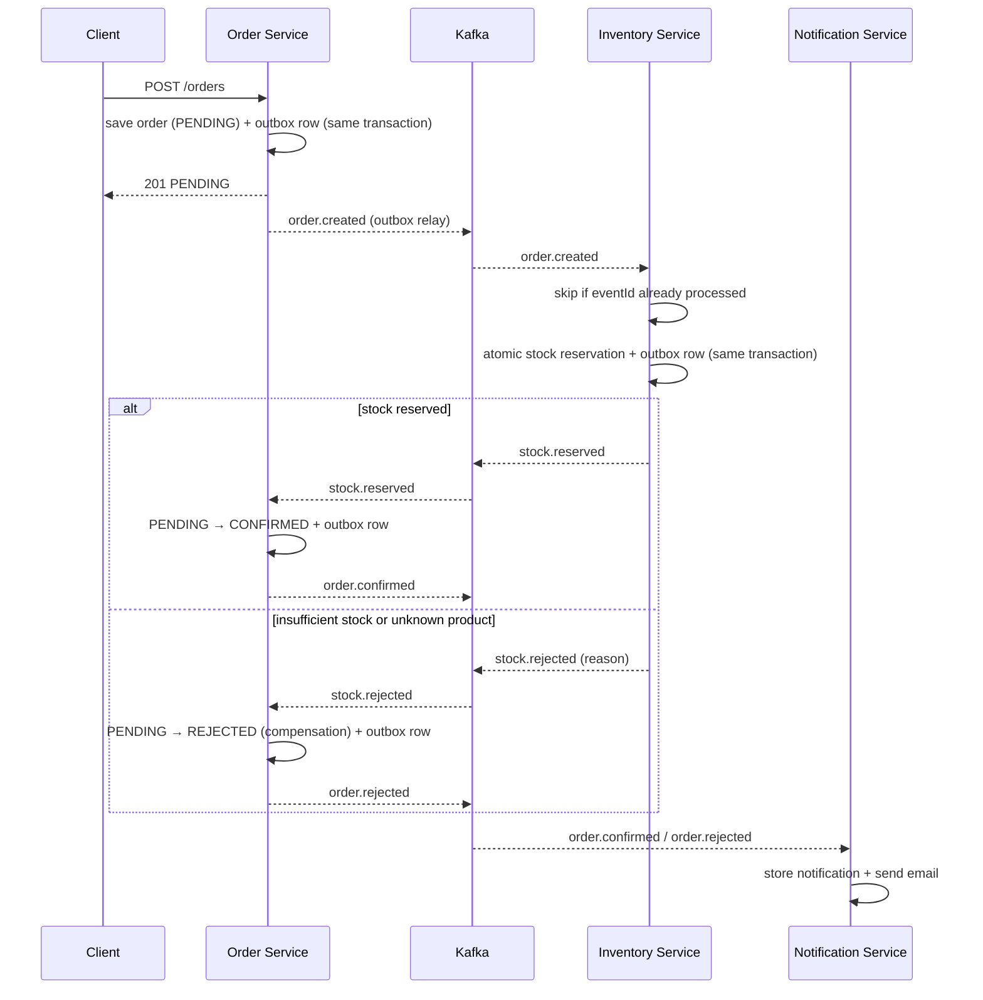

# DevSecOps Project: Order Saga

Order management with stock reservation and user notification, built as a set of Spring Boot microservices to practice the problems that distributed systems frequently raise: data consistency across services, partial failures, idempotency, as well as **DevSecOps** best practices: securing service-to-service communication (identity, mTLS, encrypted broker, network isolation) and proving it with reproducible attack scenarios.

The business domain is deliberately simple (ordering products and reserving stock + user notification) so that the effort goes into engineering rather than business logic.

## Tech stack

Java 25, Spring Boot 4.1.2, Maven (wrapper included), PostgreSQL 16 (Order, Inventory, Notification), Spring Cloud Gateway (WebFlux), Kafka, Mailpit, Flyway, JUnit 5, Testcontainers, Docker Compose.

## Quick start

**Prerequisites**

- Docker Desktop (running) with Compose
- A JDK 17+ in the `PATH` (provides `keytool`, used to generate the TLS certificates)
- PowerShell 5.1+ (Windows) to run the initialisation scripts

**1. Clone the repository**

```powershell
git clone https://github.com/mayssa-zennou/DevSecOps-project.git
cd DevSecOps-project
```

**2. Create the `.env` file**

```powershell
Copy-Item .env.example .env
```

Fill in every `CHANGEME` with your own long random values (no spaces, quotes or special characters).
`CLUSTER_ID` can be generated with:

```powershell
docker run --rm apache/kafka:3.9.0 /opt/kafka/bin/kafka-storage.sh random-uuid
```

`.env` and `secrets/` are ignored by Git: never commit them.

**3. Generate the TLS certificates** (local CA, broker keystore, clients truststore)

Run the certificate script of the project from Git Bash or WSL. It creates `secrets/ca/` and `secrets/kafka/`.
The script reads `KAFKA_SSL_PASSWORD` from the shell environment (it does not load `.env`); export it before running, for example `export KAFKA_SSL_PASSWORD='your-alphanumeric-password'`.
Each developer generates their own CA: certificates are not shared. To regenerate them, remove `secrets/` first because `keytool` will fail when the aliases already exist. The CA private key is stored in `secrets/ca/ca.p12`; `secrets/` is ignored by Git. The broker certificate is valid for 365 days.

**4. Start Kafka first**

```powershell
docker compose up -d kafka
```

Kafka starts with only the `admin` account (created at storage format time). Wait until its container is running before initialising it.

**5. Initialise Kafka (accounts, topics, ACLs)**

```powershell
.\scripts\init-kafka.ps1
```

If PowerShell blocks the script:

```powershell
powershell -ExecutionPolicy Bypass -File .\scripts\init-kafka.ps1
```

The script checks the prerequisites, waits for Kafka, then creates:

- the SCRAM accounts `order-service`, `inventory-service`, `notification-service`
- the topics `order.created`, `stock.reserved`, `stock.rejected`, `order.confirmed`, `order.rejected`
- the ACLs (least privilege): each service can only produce/consume the topics it needs

**6. Start the remaining services** only after initialisation completes:

```powershell
docker compose up -d --build
docker compose ps
```

This order prevents application clients from connecting before their SCRAM accounts and ACLs exist. The initialisation script can be run again safely after Kafka data is reset.

If the services were already running during initialisation, restart them:

```powershell
docker compose restart order-service inventory-service notification-service
```

**7. Check**

```powershell
docker compose ps
curl.exe -i -X POST http://localhost:8080/orders -H "Content-Type: application/json" -d "{\"productId\":\"SKU-42\",\"quantity\":3}"
```

The order goes from `PENDING` to `CONFIRMED`, and the email appears in Mailpit (http://localhost:8025).

> `docker compose down -v` deletes the Kafka volume (accounts, topics, ACLs) and the databases:
> run `init-kafka.ps1` again afterwards.

## Order saga

Order processing is a choreographed saga across the order, inventory, and notification services: there is no central orchestrator, each service reacts to the events of the others and Kafka only transports them. Creating an order returns it as `PENDING`; the final state arrives asynchronously.



The order is created before the stock is known, so a failed reservation is compensated by moving it to `REJECTED` rather than deleting it. Nothing changes in inventory on a failed reservation, so no stock has to be released.

**Message reliability.** Order and Inventory never publish to Kafka from their business logic: each event is written to an `outbox` table in the same transaction as the state change, and a relay publishes it afterwards. Delivery is therefore at-least-once: an event is never lost when the broker is down, but it may be published twice. Consumers are idempotent: Inventory records processed `eventId`s, Order only transitions orders that are still `PENDING`, and Notification relies on a unique `event_id`.

Topics, event schemas, idempotency rules and naming conventions are documented in [`docs/contracts.md`](docs/contracts.md).

**Known limitations:** there is no timeout on `PENDING` orders and no dead-letter topic, so an order whose result never arrives stays `PENDING`; published outbox rows are never purged; the polling relay (500 ms) adds some latency that a CDC tool such as Debezium would remove; sending an email is not transactional, so a duplicate email is possible if the commit fails after the send.

## Services and ports

| Service | Port | Storage |
|---|---|---|
| Order Service | 8081 | PostgreSQL `orders` (host port 5432) |
| Inventory Service | 8082 | PostgreSQL `inventory` (host port 5433) |
| Notification Service | 8083 | PostgreSQL `notification` (host port 5434) |
| API Gateway | 8080 | none |
| Kafka | 9092 | none |
| Mailpit | web UI 8025 and SMTP 1025 | none |

## API

### Order Service (`:8081`)

| Method | Path | Description | Responses |
|---|---|---|---|
| `POST` | `/orders` | Create an order (starts as `PENDING`) | `201`, `400` invalid body |
| `GET` | `/orders/{id}` | Read one order | `200`, `404` unknown id, `400` malformed id |
| `GET` | `/orders` | List orders | `200` |

Body of `POST /orders`: `{"productId": "SKU-42", "quantity": 3}` (`productId` not blank, `quantity` at least 1).

Order statuses: `PENDING`, `CONFIRMED`, `REJECTED`.

### Inventory Service (`:8082`)

| Method | Path | Description | Responses |
|---|---|---|---|
| `GET` | `/stock/{productId}` | Available quantity of a product | `200`, `404` unknown product |
| `POST` | `/stock/{productId}/reservations` | Reserve a quantity | `200` reserved, `409` insufficient stock, `404` unknown product, `400` invalid quantity |

Body of a reservation: `{"quantity": 30}`. Demo data: `SKU-42` is seeded with 100 units.

### Notification Service (`:8083`)

| Method | Path | Description |
|---|---|---|
| `GET` | `/notifications` | Return all stored notifications |
| `GET` | `/notifications/user/{userId}` | Return notifications for the specified user |

The order service currently publishes provisional user data (`alice`, `alice@test.com`), which is used as the notification recipient. Mailpit's web interface is available at `http://localhost:8025` when the Compose stack is running.

### API Gateway (`:8080`)

The Spring Cloud Gateway WebFlux application forwards these paths without changing them. In Docker Compose, it uses the service names on the internal network:

| Path | Configured upstream |
|---|---|
| `/orders` and `/orders/**` | `order-service:8081` |
| `/stock` and `/stock/**` | `inventory-service:8082` |
| `/notifications` and `/notifications/**` | `notification-service:8083` |

When running the gateway directly from your IDE or Maven, the default upstream URLs point to `localhost:8081`, `:8082`, and `:8083`. To rebuild and start only the gateway container after changing it:

```bash
docker compose up -d --build api-gateway
docker compose logs -f api-gateway
```

To start the gateway locally instead of in Docker, with the other services already running:

```bash
cd services/api-gateway
./mvnw spring-boot:run
```

On Windows, use:

```powershell
cd services/api-gateway
.\mvnw.cmd spring-boot:run
```

## Try it with curl

```bash
# Create an order through the gateway
curl -i -X POST http://localhost:8080/orders \
  -H "Content-Type: application/json" \
  -d '{"productId":"SKU-42","quantity":3}'

# Read / list orders through the gateway
curl -i http://localhost:8080/orders
curl -i http://localhost:8080/orders/<order-id>

# Check the stock through the gateway
curl -i http://localhost:8080/stock/SKU-42

# List notifications through the gateway
curl -i http://localhost:8080/notifications

# Reserve 30 units
curl -i -X POST http://localhost:8080/stock/SKU-42/reservations \
  -H "Content-Type: application/json" \
  -d '{"quantity":30}'
```

> On Windows PowerShell, use `curl.exe` and escape the JSON quotes (`-d '{\"quantity\":30}'`), or use Postman or Bruno.

## Tests

Docker must be running: Testcontainers starts its own throwaway databases, independent from the Compose ones.

```bash
cd services/order-service && ./mvnw test
cd services/inventory-service && ./mvnw test
cd services/notification-service && ./mvnw test
```

On Windows use `.\mvnw.cmd test`.

## Local development

Run a service from the IDE: start its dependencies, then launch the application. Order and inventory use `application.yml`; notification and the gateway use `application.properties`. Notification's properties point to PostgreSQL at `localhost:5434`, Kafka at `localhost:9092`, and SMTP at `localhost:1025`.

```bash
docker compose up -d orders-db inventory-db notification-db kafka mailpit
```

Inspect a database:

| Service | Database | Host port | User | Password |
|---|---|---|---|---|
| orders-db | `orders` | 5432 | mayssa | orders |
| inventory-db | `inventory` | 5433 | mayssa | inventory |
| notification-db | `notification` | 5434 | nazha | notification |

```bash
docker compose exec <service> psql -U <user> -d <db>
```

In `psql`: `\dt` lists tables, `\d stock` describes a table, `SELECT * FROM flyway_schema_history;` shows applied migrations, `\q` quits.
